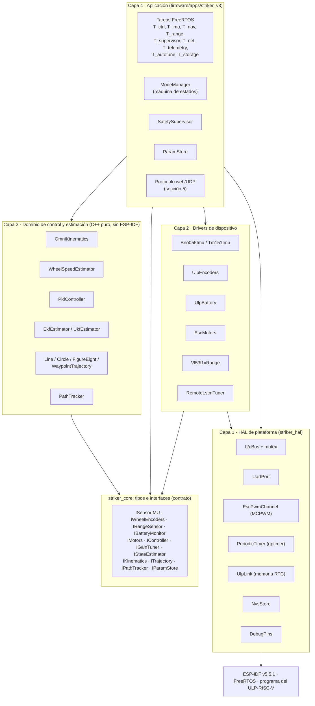
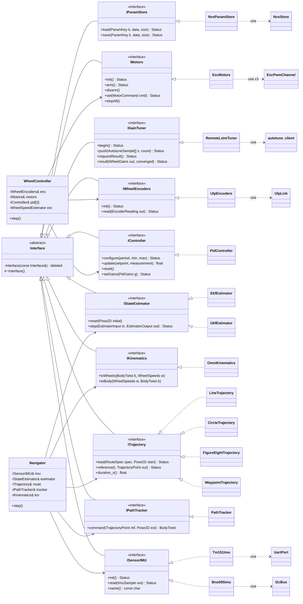
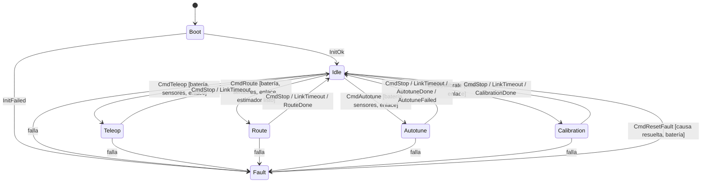

# Entrega 1 · Sección 2 — Arquitectura por capas y diagrama de clases

**Proyecto:** firmware unificado Striker v3 (ESP32-S3) · Howlers FC / Robosyn · Universidad de Antioquia
**Rama:** `entrega-1` de `afzo1/howlers-source` · **Fecha:** 18 de noviembre de 2026
**Contrato C++:** [`firmware/components/striker_core`](../../firmware/components/striker_core/README.md) (solo encabezados, verificados con [`verificar_interfaces.sh`](herramientas/verificar_interfaces.sh))

---

## Resumen

1. El firmware se organiza en **4 capas**: HAL de plataforma, drivers de dispositivo, dominio de control y estimación, y aplicación con máquina de estados. Cada capa solo usa la de abajo, y la capa de dominio no incluye nada de ESP-IDF: se puede compilar y probar en el PC.
2. Cada módulo es un **componente ESP-IDF real**, con su `CMakeLists.txt` y sus dependencias declaradas (hallazgo A1). De cada driver de `firmware/components/` se toma **una sola versión**, la mejor de las existentes, y se adapta lo mínimo (hallazgos A2 y A3).
3. Las capas 2 y 3 se comunican por **interfaces C++ abstractas** (`ISensorIMU`, `IWheelEncoders`, `IMotors`, `IController`, `IStateEstimator`, entre otras). Cambiar la IMU de Striker 1 por la de Striker 2, o el PID por otro controlador, no toca la tarea de navegación.
4. **Un solo binario** sirve para los dos robots: al arrancar se elige la tabla de pines, geometría y ESC del robot (`RobotConfig`). Mientras no se sepa qué robot es, ningún pin se configura como salida.
5. La aplicación es una **máquina de estados** con 7 modos (Boot, Idle, Teleop, Route, Autotune, Calibration y Fault). Su función de transición es pura y `constexpr`, y sus reglas de seguridad se comprueban al compilar.
6. C++ determinista: sin excepciones, sin RTTI, sin memoria dinámica después del arranque. La prueba del contrato compila para el ESP32-S3 sin una sola referencia a `malloc`, `operator new` o al soporte de excepciones.

---

## 2.1 Requisitos que guían la arquitectura

| Requisito | Origen | Cómo lo cumple v3 |
|---|---|---|
| El código de alto nivel no depende de si el robot es Striker 1 o Striker 2 | Guía, eje 2 | Interfaces en la frontera capa 2 → capa 3 (2.5) y `RobotConfig` (2.6) |
| Reutilizar los drivers de `firmware/components/` | Guía, eje 2 | Un componente canónico por driver, derivado de la mejor variante existente (2.4) |
| Componentes con fronteras y dependencias declaradas | Hallazgo A1 | Componentes ESP-IDF con `idf_component_register` y `REQUIRES` (2.3) |
| Una sola implementación por driver, con unidades explícitas | Hallazgos A2, A3 y N2 | Componentes canónicos; unidades del SI en el contrato (2.4 y 2.5) |
| Capas separadas: comunicaciones fuera de la HAL, control fuera de las tareas | Hallazgo A4 | Reglas de dependencia (2.2) |
| Una sola fuente de configuración | Hallazgo A5 | `RobotConfig` + Kconfig + NVS con versión y CRC (2.6) |
| Los modos (calibración, autotuning) dentro del mismo firmware | Hallazgo A6, guía eje 6 | Máquina de estados (2.7) |
| C++ sin `new`/`malloc` en los lazos, sin excepciones ni RTTI | Guía, eje 2 | Reglas de 2.8, verificadas automáticamente |
| Ningún movimiento sin orden explícita | Hallazgo F4 y reglas del proyecto | Boot e Idle desarmados; armar solo al entrar a un modo de movimiento (2.7) |

---

## 2.2 Vista general: cuatro capas



**Reglas de dependencia** (se revisan en cada `CMakeLists.txt`):

1. Una capa solo incluye encabezados de su propia capa, de las de abajo y de `striker_core`.
2. La **capa 3 no incluye nada de ESP-IDF ni de FreeRTOS**: recibe datos y devuelve resultados. Sus pruebas unitarias corren en el PC.
3. La **capa 2 implementa las interfaces** de `striker_core` envolviendo los drivers C existentes (patrón adaptador). No conoce tareas ni colas.
4. La **capa 4 es la única que crea objetos y tareas** ("raíz de composición"): en el arranque instancia los objetos estáticos del robot elegido y pasa referencias a interfaces a quien las necesita (inyección de dependencias).
5. Las comunicaciones con la app web (capa 4) no viven en la HAL, al revés de lo que pasaba en Striker 1 (hallazgo A4).

---

## 2.3 Componentes ESP-IDF y estructura de carpetas

Estructura objetivo de v3. Lo marcado con ✅ ya existe; lo demás se crea en la Entrega 2.

```text
firmware/
├── components/
│   ├── striker_core/             ✅ capa 3·contrato: tipos e interfaces (solo encabezados)
│   ├── striker_hal/                 capa 1: envolturas C++ de I2C, UART, MCPWM, gptimer, NVS, ULP
│   ├── striker_domain/              capa 3: cinemática, estimador de velocidad, PID, trayectorias, seguidor
│   ├── sensors/
│   │   ├── as5600/   (CMakeLists + include/ + src/)   driver canónico
│   │   ├── bno055/   (ídem)
│   │   ├── tm151/    (ídem)
│   │   ├── vl53l1x/  (ídem)
│   │   └── …/v1_striker1, v2_striker2, standalone    variantes viejas, intactas (las usan las apps viejas)
│   ├── actuators/bldc_pwm/       driver canónico
│   ├── control/
│   │   ├── pid_lib/              driver canónico (ecuación de pid_ext)
│   │   └── state_estimation/     EKF y UKF de la suite de estimación, con memoria estática
│   └── comms/autotune_client/    telemetry.c del banco, como componente
└── apps/striker_v3/
    ├── CMakeLists.txt            EXTRA_COMPONENT_DIRS con la lista explícita de componentes
    ├── sdkconfig.defaults        placa N16R8, afinidades, IRAM, PSRAM (secciones 3 y 4.5)
    ├── particiones_v3.csv        sección 4.6
    ├── main/                     capa 4: app_main, tareas, ModeManager, BSP de cada robot
    └── ulp/                      programa del ULP-RISC-V (sección 4.8)
```

**Componente canónico.** Para cada dispositivo, el componente de v3 vive en la raíz de su carpeta (`sensors/bno055/CMakeLists.txt`, `include/`, `src/`) y se construye a partir de una sola de las variantes existentes. Las variantes viejas (`v1_striker1`, `v2_striker2`, `standalone`) no se mueven ni se modifican mientras existan las apps viejas, que las compilan con rutas relativas; como los `SRCS` del componente son explícitos, ESP-IDF las ignora. Cuando v3 esté validado se podrán archivar.

**Dependencias declaradas.** Cada componente lista lo que usa, por ejemplo:

| Componente | `REQUIRES` |
|---|---|
| `striker_core` | (ninguno) |
| `striker_domain` | `striker_core` |
| `striker_hal` | `striker_core`, `esp_driver_i2c`, `esp_driver_uart`, `esp_driver_mcpwm`, `esp_driver_gptimer`, `nvs_flash`, `ulp` |
| `bno055`, `vl53l1x`, `as5600` | `striker_hal` (solo el puerto I2C, ver 2.4) |
| `tm151` | (ninguno: es el protocolo; el transporte lo pone el adaptador) |
| `pid_lib`, `state_estimation` | (ninguno: C puro) |
| `main` de `striker_v3` | todos los anteriores, `esp_wifi`, `esp_netif`, `lwip` |

---

## 2.4 Reutilización de `firmware/components/`

### 2.4.1 Qué versión se toma de cada driver

| Driver | Variantes que existen | Base para v3 | Por qué | Cambios necesarios |
|---|---|---|---|---|
| AS5600 (encoder) | `v1_striker1` (grados), `v2_striker2` (radianes), `standalone` | `v2_striker2` | Radianes (SI); incluye configuración y quemado por I2C | En v3 el ángulo **no** lo lee este driver sino el ULP (sección 4.8). Se reutilizan la conversión tensión → ángulo y, para un procedimiento de banco, la configuración por I2C (modo de salida analógico, rango). En el firmware del robot S2 esa configuración está comentada ([`functions.c:56-64`](https://github.com/afzo1/howlers-source/blob/0451897bc2c902e6e356acf153d503e0143c7b3a/firmware/apps/striker_v2/Robot-Control/main/functions.c#L56-L64)) y los tres sensores tienen la misma dirección I2C ([`as5600_lib.h:41`](https://github.com/afzo1/howlers-source/blob/0451897bc2c902e6e356acf153d503e0143c7b3a/firmware/components/sensors/as5600/v2_striker2/as5600_lib.h#L41)): mientras no se confirme ese cableado, el modo Calibración del robot solo **mide**, sin reprogramar los sensores |
| BNO055 (IMU, S2) | `v2_striker2`, `standalone` | `v2_striker2` | Es la que corre en `Robot-Control`, el firmware más reciente de Striker 2 | Recibir un dispositivo I2C de la HAL en lugar de crear el bus por su cuenta (2.4.2) |
| TM151 (IMU, S1) | `v1_striker1`, `standalone` (copia) | Biblioteca EasyProfile de `v1_striker1` | Es el protocolo del fabricante | Corregir `BasicTypes.h` (2.4.3). `EasyRetrieve.c`, que depende de la HAL vieja, se reemplaza por el adaptador `Tm151Imu` |
| VL53L1X (distancia) | `v1_striker1`, `v2_striker2`, `standalone` | `v2_striker2` | La integrada más reciente; las otras difieren en ajustes menores | Inyección del dispositivo I2C |
| BLDC/ESC | `v1_striker1`, `v2_striker2`, `autotuning` | Configuración MCPWM de `v2_striker2`, con un modelo de pulsos explícito | La misma función significa cosas distintas según la variante (2.4.4) | Los anchos de pulso salen de `RobotConfig::esc_pulse` en microsegundos |
| PID | `v1_striker1`, `v2_striker2`, `autotuning_rnn` | `autotuning_rnn` (`pid_ext`) | Es la ecuación discreta con la que se entrenaron los modelos LSTM: usar otra invalida las ganancias que devuelve el autotuning | Inicialización sobre memoria estática (hoy usa [`calloc`](https://github.com/afzo1/howlers-source/blob/0451897bc2c902e6e356acf153d503e0143c7b3a/firmware/components/control/pid_lib/autotuning_rnn/pid_ext.c#L119)); coeficientes precalculados al cambiar ganancias; revisión numérica en la sección 5 |
| Fusión / velocidad de rueda | `v1_striker1`, `autotuning` | Método de `autotuning` (`estimate_velocity_encoder`) | Los modelos LSTM vieron velocidades estimadas con ese método | Se reescribe como `WheelSpeedEstimator` (capa 3) con el mismo filtro |
| HAL de plataforma | 3 variantes y 8 copias de `platform_esp32s3.c` (7 distintas, hallazgo A2) | Ninguna | Mezclan capas (A4) y usan drivers I2C anteriores a ESP-IDF 5 | Se reemplaza por `striker_hal` |
| WiFi/UDP y consola UART | `wifi_udp/v1_striker1`, `uart_console/v2_striker2` | Ninguna | Protocolos ad hoc (hallazgo F6) | Nuevo protocolo en la sección 5 |
| Cliente TCP del autotuning | `bench_pid_autotuning/main/telemetry.c` | Se reutiliza tal cual | Compatibilidad con `python_server.py` y los modelos entrenados | Pasa a componente; sin inicialización propia del WiFi; con tiempos de espera |
| EKF y UKF | Suite de estimación (repositorio externo) | `State Estimation_C/esp32s3_test` | Ya está en `float`, con API genérica y el modelo del robot omnidireccional | Memoria estática; el UKF reserva memoria en cada paso (2.4.5) |

### 2.4.2 Cómo se desacopla un driver C de la plataforma

Los drivers C viejos incluyen `platform_esp32s3.h` y crean ellos mismos el bus (`i2c_init(...)` dentro de `BNO055_Init`). Eso los ata a una de las 7 copias de la HAL. En v3 se aplica **inyección de dependencias en C**: el driver recibe un pequeño puerto con punteros a función, que implementa `striker_hal`.

```c
// Puerto I2C que reciben los drivers canónicos (C puro)
typedef struct {
    void *ctx;                                                           // dispositivo de la HAL
    int (*read_reg)(void *ctx, uint8_t reg, uint8_t *data, size_t len);  // 0 = éxito
    int (*write_reg)(void *ctx, uint8_t reg, const uint8_t *data, size_t len);
} sk_i2c_port_t;

int8_t BNO055_Init(BNO055_t *bno055, const sk_i2c_port_t *port, uint8_t rst_gpio);
```

El cambio en cada driver es mecánico (reemplazar 3 o 4 llamadas y la firma de la inicialización), conserva todo el conocimiento del dispositivo y permite probar el driver con un puerto falso en el PC. La HAL implementa `read_reg`/`write_reg` tomando el **mutex del bus** (sección 3.5).

### 2.4.3 Hallazgo nuevo: tipos enteros del TM151 mal definidos para el ESP32

Al revisar la biblioteca EasyProfile para reutilizarla apareció un defecto que no estaba en el diagnóstico: [`BasicTypes.h:44`](https://github.com/afzo1/howlers-source/blob/0451897bc2c902e6e356acf153d503e0143c7b3a/firmware/components/sensors/tm151/v1_striker1/include/BasicTypes.h#L44) selecciona la plataforma `EP_STC32_C251_`, que define `uint16` como `unsigned int` y `int16` como `signed int` ([líneas 116-125](https://github.com/afzo1/howlers-source/blob/0451897bc2c902e6e356acf153d503e0143c7b3a/firmware/components/sensors/tm151/v1_striker1/include/BasicTypes.h#L116-L125)). En ese microcontrolador `int` mide 16 bits; en el ESP32-S3 mide **32**. Las estructuras con campos de 16 bits, como `Ep_Combo` ([`EasyObjectDictionary.h:157-159`](https://github.com/afzo1/howlers-source/blob/0451897bc2c902e6e356acf153d503e0143c7b3a/firmware/components/sensors/tm151/v1_striker1/include/EasyObjectDictionary.h#L157-L159)), quedan con otro tamaño y se decodifican mal. Los paquetes que usaba Striker 1 (`Ep_RPY`, en `float`) no se ven afectados, por eso no se notaba. **Corrección en el componente canónico:** seleccionar `SA_PLATFORM_DEFAULT_`, que usa `<stdint.h>`, y comprobar con `static_assert` el tamaño de cada estructura del protocolo.

### 2.4.4 Ejemplo de la deriva entre variantes: el sentido del ESC

En `bldc_set_duty_motor`, la versión compartida de Striker 2 envía 70 % en la señal de sentido para avanzar y 30 % para retroceder ([`bldc_pwm.c:120-123`](https://github.com/afzo1/howlers-source/blob/0451897bc2c902e6e356acf153d503e0143c7b3a/firmware/components/actuators/bldc_pwm/v2_striker2/bldc_pwm.c#L120-L123)); la copia original de `Velocity-Control` hace lo contrario ([`bldc_pwm.c:120-123`](../../firmware/apps/striker_v2/Velocity-Control/local_drivers/drivers/bldc_pwm/bldc_pwm.c#L120-L123)). Los comentarios de las dos dicen "40 %", un valor que ninguna usa. Por eso en v3 el driver no decide nada por su cuenta: aplica los microsegundos de `RobotConfig::esc_pulse` y el signo de `RobotConfig::geometry.motor_sign`, que se confirman en el modo Calibración.

### 2.4.5 La suite de estimación: lista para usar, salvo la memoria del UKF

El código C de la suite ya cumple lo más importante: todo es `float` y su API es genérica (el usuario da `f(x, u)`, `h(x)` y sus jacobianos). El modelo del robot coincide con lo que necesita v3: estado `[x, y, ψ, vx, vy, ω]`, entrada `[ax, ay]` de la IMU, medición `[vx, vy, ω, ψ]` y paso de 10 ms ([`robot_model.h:30-39`](https://github.com/MaverickST/mobile-robot-estimation-suite/blob/95e65d26351ac6f22d22e28b96c52dad0d63aa69/State%20Estimation_C/esp32s3_test/main/robot_model.h#L30-L39)), el mismo periodo de `T_nav` (sección 3).

Dos ajustes antes de integrarla:
- El **EKF** reserva toda su memoria en `ekf_init` ([`ekf.c:66-75`](https://github.com/MaverickST/mobile-robot-estimation-suite/blob/95e65d26351ac6f22d22e28b96c52dad0d63aa69/State%20Estimation_C/esp32s3_test/main/ekf.c#L66-L75)) y no dentro de `ekf_predict`/`ekf_update`. Cumple la regla, pero en v3 recibirá buffers estáticos en DRAM interna, para que su ubicación sea explícita (sección 4).
- El **UKF reserva y libera memoria en cada paso**: `ukf_predict` ([`ukf.c:488`](https://github.com/MaverickST/mobile-robot-estimation-suite/blob/95e65d26351ac6f22d22e28b96c52dad0d63aa69/State%20Estimation_C/esp32s3_test/main/ukf.c#L488)) y `ukf_update` ([`ukf.c:530`](https://github.com/MaverickST/mobile-robot-estimation-suite/blob/95e65d26351ac6f22d22e28b96c52dad0d63aa69/State%20Estimation_C/esp32s3_test/main/ukf.c#L530), [`:557-558`](https://github.com/MaverickST/mobile-robot-estimation-suite/blob/95e65d26351ac6f22d22e28b96c52dad0d63aa69/State%20Estimation_C/esp32s3_test/main/ukf.c#L557-L558), [`:668`](https://github.com/MaverickST/mobile-robot-estimation-suite/blob/95e65d26351ac6f22d22e28b96c52dad0d63aa69/State%20Estimation_C/esp32s3_test/main/ukf.c#L668)). Eso viola la regla del eje 2 y da tiempos impredecibles. Se corrige moviendo esos temporales a la estructura del filtro, reservada una sola vez.

Por eso el estimador por defecto de v3 es el **EKF**; el UKF queda como alternativa detrás de la misma interfaz, y la comparación de costo y precisión entre los dos va en la sección 5.

### 2.4.6 Hallazgos del banco de autotuning que cambian el diseño

El banco `bench_pid_autotuning` es la referencia del eje 6. Su README ya documenta varios problemas; los que afectan la arquitectura son:
- Hay **tres tareas de control, una por rueda**, y la de la rueda trasera corre en el Core 0, junto al WiFi ([`firmware_main.c:694-696`](https://github.com/afzo1/howlers-source/blob/0451897bc2c902e6e356acf153d503e0143c7b3a/firmware/apps/bench_pid_autotuning/main/firmware_main.c#L694-L696)). El generador de trayectoria, llamado desde las tres, avanza tres veces por milisegundo.
- La tarea de telemetría **toma las muestras** con `vTaskDelay(1)` desde el Core 0 y deja huecos mientras envía por TCP.

En v3 hay **una sola tarea de ruedas** (`T_ctrl`, Core 1) que actualiza las tres; ella misma **produce las muestras de 1 kHz** del autotuning en un buffer, y `T_autotune` (Core 0) solo las envía. Así el muestreo no depende de la red (sección 3).

---

## 2.5 Interfaces C++ y diagrama de clases

### 2.5.1 Interfaces del contrato

Están en [`firmware/components/striker_core/include/striker/`](../../firmware/components/striker_core/include/striker/striker.hpp). La guía pedía, por ejemplo, `ISensorIMU`, `IWheelEncoder` e `IController`; v3 define estas:

| Interfaz | Archivo | Responsabilidad | Implementaciones previstas | Quién la usa (tarea · núcleo · frecuencia) |
|---|---|---|---|---|
| `ISensorIMU` | [`sensors.hpp`](../../firmware/components/striker_core/include/striker/sensors.hpp) | Rumbo, velocidad de giro y aceleración del cuerpo | `Bno055Imu` (S2), `Tm151Imu` (S1) | `T_imu` · 1 · 100 Hz |
| `IWheelEncoders` | `sensors.hpp` | Ángulo de las 3 ruedas en la misma ronda de muestreo | `UlpEncoders` | `T_ctrl` · 1 · 1 kHz |
| `IRangeSensor` | `sensors.hpp` | Distancia al frente | `Vl53l1xRange` | `T_range` · 1 · 20 Hz |
| `IBatteryMonitor` | `sensors.hpp` | Tensión y umbrales de la batería | `UlpBattery` | `T_supervisor` · 0 · 50 Hz |
| `IMotors` | [`actuators.hpp`](../../firmware/components/striker_core/include/striker/actuators.hpp) | Órdenes a los 3 ESC; armado y parada | `EscMotors` | `T_ctrl` · 1 · 1 kHz; armado: `T_supervisor` |
| `IController` | [`control.hpp`](../../firmware/components/striker_core/include/striker/control.hpp) | Controlador SISO de periodo fijo | `PidController` | `T_ctrl` (3 instancias) |
| `IGainTuner` | `control.hpp` | Estrategia de autosintonización | `RemoteLstmTuner`; opcional `OnDeviceLstmTuner` | `T_autotune` · 0 |
| `IStateEstimator` | [`estimation.hpp`](../../firmware/components/striker_core/include/striker/estimation.hpp) | Pose del robot | `EkfEstimator`, `UkfEstimator` | `T_nav` · 1 · 100 Hz |
| `IKinematics` | [`motion.hpp`](../../firmware/components/striker_core/include/striker/motion.hpp) | Cinemática directa e inversa | `OmniKinematics` | `T_nav`, `T_ctrl` |
| `ITrajectory` | `motion.hpp` | Referencia de una ruta en el tiempo | `LineTrajectory`, `CircleTrajectory`, `FigureEightTrajectory`, `WaypointTrajectory` | `T_nav` |
| `IPathTracker` | `motion.hpp` | Velocidad del cuerpo a partir del error de pose | `PathTracker` | `T_nav` |
| `IParamStore` | [`storage.hpp`](../../firmware/components/striker_core/include/striker/storage.hpp) | Parámetros persistentes con versión y CRC | `NvsParamStore` | `T_storage`; lectura al arrancar |

Los encoders y los motores se modelan como **conjuntos de 3** (`IWheelEncoders`, `IMotors`) y no rueda por rueda: así los tres ángulos vienen de la misma ronda de muestreo y las tres órdenes se aplican en el mismo ciclo, que es lo que necesita la cinemática.

### 2.5.2 Reglas del contrato

1. **Unidades del SI** en todos los campos, con sufijo en el nombre (`_m`, `_rad_s`, `_us`, `_pct`). Termina con las unidades mezcladas de los firmwares viejos (hallazgo N2).
2. **Solo `float`.** La FPU del ESP32-S3 es de 32 bits (hallazgo N1).
3. **Sin excepciones:** todo devuelve `Status` y todos los métodos son `noexcept`.
4. **Datos trivialmente copiables:** todo lo que viaja por colas de FreeRTOS o se guarda en NVS se puede copiar byte a byte (comprobado con `static_assert`).
5. **Interfaces no copiables y con destructor protegido** ([`interface.hpp`](../../firmware/components/striker_core/include/striker/interface.hpp)): nadie puede copiar ni destruir un objeto a través de su interfaz; los objetos de v3 son estáticos y viven todo el programa.
6. **Tamaños fijos:** las rutas usan `RouteSpec` con un máximo de 32 puntos, sin contenedores dinámicos.
7. **Compatibilidad con el autotuning:** `AutotuneSample` tiene exactamente el formato de 64 bytes de `robot_sample_t` del banco; un `static_assert` lo garantiza.

### 2.5.3 Diagrama de clases



`WheelController` (lo que ejecuta `T_ctrl`) y `Navigator` (lo que ejecuta `T_nav`) solo conocen interfaces. Con eso se cumple el criterio de la guía: cambiar la IMU, el estimador o el controlador no modifica la tarea de navegación.

### 2.5.4 Verificación del contrato

[`verificar_contrato.cpp`](../../firmware/components/striker_core/test/verificar_contrato.cpp) implementa cada interfaz con objetos estáticos mínimos y escribe un ciclo del lazo de ruedas y uno de navegación usando solo las interfaces. [`verificar_interfaces.sh`](herramientas/verificar_interfaces.sh) lo compila con `-fno-exceptions -fno-rtti -Wall -Wextra -Wpedantic -Wshadow -Wconversion -Werror` y, con la opción `--idf`, también dentro de un proyecto ESP-IDF mínimo que usa `striker_core` como componente:

```text
PC (c++17): compila sin avisos
PC (c++20): compila sin avisos
ESP32-S3 (gnu++2b, 14.2.0): compila sin avisos
ESP32-S3: sin malloc, sin operator new, sin RTTI y sin excepciones
Simbolos externos que necesita el objeto: (ninguno)
ESP-IDF v5.5.1: striker_core compila como componente (idf.py build)
```

---

## 2.6 Un binario para los dos robots: `RobotConfig`

### 2.6.1 Selección del robot

El tipo [`RobotConfig`](../../firmware/components/striker_core/include/striker/robot_config.hpp) reúne en un solo lugar todo lo que cambia entre robots: pines, modelo de pulsos del ESC, tipo de IMU, canales del ADC, geometría y límites. Hay una tabla constante por robot (el "BSP", paquete de soporte de la placa) en `main/bsp/`.

Al arrancar, `app_main`:
1. Lee la variante guardada en NVS. Si no hay, usa la de Kconfig (`CONFIG_STRIKER_ROBOT_S1` o `_S2`).
2. Si la variante es desconocida, **no configura ningún pin como salida** y queda en Fault esperando que el operador la indique (igual que `striker_hw_test`).
3. Si la conoce, construye los objetos de ese robot (por ejemplo `Bno055Imu` o `Tm151Imu`, ambos estáticos) y pasa sus interfaces a las tareas.

Se prefirió un binario único a uno por robot porque el equipo alterna entre los dos y así no hay que recompilar; el costo es tener en flash los dos drivers de IMU, unos pocos kilobytes.

### 2.6.2 Datos de cada robot

Los pines y los pulsos salen de los firmwares originales (ya concentrados en [`striker_hw_test`](../../firmware/apps/striker_hw_test/README.md#pines-tomados-de-los-firmwares-originales)). La geometría tiene incoherencias que se resuelven midiendo en el robot.

| Dato | Striker 1 | Striker 2 | Fuente / nota |
|---|---|---|---|
| Motor 1: acelerador / sentido | GPIO20 / GPIO21 | GPIO17 / GPIO18 | Firmwares originales |
| Motor 2: acelerador / sentido | GPIO47 / GPIO48 | GPIO8 / GPIO3 | ídem |
| Motor 3: acelerador / sentido | GPIO45 / GPIO0 | GPIO46 / GPIO9 | ídem |
| Pulso de parada / 100 % | 700 µs / 2400 µs | 1000 µs / 2400 µs | ídem |
| Sentido adelante / reversa | 860 µs / 2220 µs | 1980 µs / 1420 µs | ídem; el sentido real se confirma en Calibración |
| Encoders AS5600 (canal de ADC1) | GPIO5, 6, 7 (CH4, CH5, CH6) | GPIO6, 7, 1 (CH5, CH6, CH0) | ídem |
| IMU | TM151 por UART (TX 17, RX 18) | BNO055 por I2C (SDA 12, SCL 11, RST 13) | ídem |
| Distancia VL53L1X | I2C SDA 41, SCL 42 | I2C SDA 39, SCL 38, XSHUT 41 | ídem |
| Batería (nuevo) | GPIO2 (ADC1 CH1) | GPIO2 (ADC1 CH1) | Libre en los dos robots; requiere un divisor (sección 4.7) |
| Pines de medición (nuevo) | GPIO14, 15, 16 | GPIO14, 15, 16 | Libres en los dos robots (sección 3.9) |
| Radio de rueda | 3,25 cm en [`mov_calculation.h:12`](https://github.com/afzo1/howlers-source/blob/0451897bc2c902e6e356acf153d503e0143c7b3a/firmware/apps/striker_v1/robot-mov/main/include/mov_calculation.h#L12), pero 3,0 cm en [`control_main.h:27`](https://github.com/afzo1/howlers-source/blob/0451897bc2c902e6e356acf153d503e0143c7b3a/firmware/apps/striker_v1/robot-mov/main/include/control_main.h#L27) | 0,03 m ([`types.h:114`](https://github.com/afzo1/howlers-source/blob/0451897bc2c902e6e356acf153d503e0143c7b3a/firmware/apps/striker_v2/Robot-Control/include/types.h#L114)) | **Medir** |
| Radio de la base | No aparece | 0,16 m, comentado como "diámetro" ([`senfusion.h:205-207`](../../firmware/apps/striker_v2/Robot-Navigation/local_drivers/control/senfusion.h#L205-L207)) | **Medir** |
| Ángulo de las ruedas (δ) | 30° ([`mov_calculation.h:10`](https://github.com/afzo1/howlers-source/blob/0451897bc2c902e6e356acf153d503e0143c7b3a/firmware/apps/striker_v1/robot-mov/main/include/mov_calculation.h#L10)) | 30° (`senfusion.h:207`) | Coinciden |
| Reducción entre encoder y rueda | 16 ([`mov_calculation.h:11`](https://github.com/afzo1/howlers-source/blob/0451897bc2c902e6e356acf153d503e0143c7b3a/firmware/apps/striker_v1/robot-mov/main/include/mov_calculation.h#L11)) | Ninguna en el código | **Verificar**: define si el AS5600 mide el eje del motor o el de la rueda |

Las incoherencias de la geometría son un caso más del hallazgo N2. En v3 cada dato existe una sola vez, en metros y radianes, y el modo Calibración lo confirma (por ejemplo, girar una rueda una vuelta y contar las vueltas del encoder da la reducción).

---

## 2.7 Máquina de estados

### 2.7.1 Diagrama



"Falla" es cualquiera de: `BatteryCritical`, `SensorFault`, `ControlOverrun`, `UlpLost` (ver [`modes.hpp`](../../firmware/components/striker_core/include/striker/modes.hpp)).

### 2.7.2 Qué hace cada modo

| Modo | Motores | Fuente de la consigna de las ruedas | Tareas activas además de las siempre activas | Escritura en NVS |
|---|---|---|---|---|
| Boot | Sin pulsos hasta conocer el robot; luego parada | — | Inicialización y autodiagnóstico | No |
| Idle | Parada (desarmados) | — | — | **Sí** (único modo) |
| Teleop | Armados | Velocidad del cuerpo enviada por la app web → cinemática inversa | — | No |
| Route | Armados | `ITrajectory` + `IPathTracker` con la pose estimada | — | No |
| Autotune | Armados | Trayectoria de excitación del banco (4 tramos) en velocidad del cuerpo | `T_autotune` (TCP) | Las ganancias se guardan después, ya en Idle |
| Calibration | Armados, con límites de `striker_hw_test` (30 %, 5 s) | Rutina de calibración | — | Después, ya en Idle |
| Fault | Parada (desarmados) | — | — | No |

Siempre activas: `T_ctrl` (con consigna cero cuando no hay movimiento), `T_imu`, `T_nav` (la estimación corre también quieto), `T_range`, `T_supervisor`, `T_net`, `T_telemetry` y el ULP.

### 2.7.3 Implementación

- La transición es la función `next(modo, evento, guardas)` de [`modes.hpp`](../../firmware/components/striker_core/include/striker/modes.hpp): pura, `constexpr` y sin efectos. La ejecuta `ModeManager` dentro de `T_supervisor` (Core 0), que además hace las acciones de entrada y salida: **armar al entrar a un modo de movimiento y desarmar al salir** (`motorsArmed()`).
- El modo activo se publica en un **grupo de eventos** (un bit por modo, sección 3.4). Las tareas del Core 1 leen esos bits al comienzo de cada ciclo.
- Las **reglas de seguridad** se comprueban al compilar, con `static_assert`, en [`verificar_contrato.cpp`](../../firmware/components/striker_core/test/verificar_contrato.cpp): Boot no se mueve con ninguna orden; moverse exige batería, sensores y enlace; perder el enlace detiene cualquier movimiento; cualquier falla lleva a Fault desde cualquier modo; de Fault solo se sale por orden del operador con la causa resuelta.
- Las protecciones rápidas no esperan al `ModeManager`: `T_ctrl` pone consigna cero por su cuenta si la consigna de `T_nav` es vieja, y pasa a parada si el ULP deja de publicar (sección 3.10).

---

## 2.8 C++ embebido determinista

| Regla | Cómo se aplica | Cómo se verifica |
|---|---|---|
| Sin excepciones | `CONFIG_COMPILER_CXX_EXCEPTIONS=n` (valor por defecto de ESP-IDF 5.5, [`Kconfig:477-483`](https://github.com/espressif/esp-idf/blob/v5.5.1/Kconfig#L477-L483)); todo devuelve `Status` | La compilación con `-fno-exceptions` y la revisión de símbolos `__cxa_*` |
| Sin RTTI | `CONFIG_COMPILER_CXX_RTTI=n` (también por defecto); polimorfismo solo con funciones virtuales; nada de `dynamic_cast` ni `typeid` | Compilación con `-fno-rtti` y revisión de símbolos `_ZTI`/`_ZTS` |
| Sin memoria dinámica después del arranque | Tareas, colas, semáforos y buffers con las variantes estáticas de FreeRTOS (`xTaskCreateStaticPinnedToCore`, `xQueueCreateStatic`, `xStreamBufferCreateStatic`, `xSemaphoreCreateMutexStatic`, `xEventGroupCreateStatic`); objetos globales o en almacenamiento estático | Revisión de símbolos de cada objeto del lazo (como en [`verificar_interfaces.sh`](herramientas/verificar_interfaces.sh)) y, en placa, rastreo del heap (`heap_trace`) durante una prueba larga: cero reservas después de que el arranque termina |
| Objetos elegidos en ejecución sin `new` | Los dos drivers de IMU existen como objetos estáticos y se elige un puntero; las trayectorias se construyen con *placement new* sobre un buffer estático del tamaño de la mayor | Revisión de código |
| Biblioteca estándar acotada | Sí: `std::array`, `<type_traits>`, `<cstdint>`, `<cmath>` en `float` (`sinf`, `sqrtf`). No: `std::vector`, `std::string`, `std::function`, `std::map`, `iostream`, que reservan memoria | Revisión de código y de símbolos |
| Nada virtual ni pesado en las ISR | Las ISR son funciones C cortas en IRAM: notifican a una tarea y salen | Revisión de código |
| Errores de programación | `configASSERT` solo en la inicialización; dentro de los lazos, `Status` y paso a Fault | Revisión de código |
| Estándar | Los encabezados son C++17 y compilan también con el estándar por defecto de ESP-IDF 5.5 (`gnu++2b`) | `verificar_interfaces.sh` |

El costo de una llamada virtual en el lazo de 1 kHz es una carga de puntero y un salto indirecto, decenas de nanosegundos: despreciable frente al presupuesto de 60 µs de `T_ctrl` (sección 3.8).

---

## 2.9 Trazabilidad

| Hallazgo | Decisión de esta sección | Dónde |
|---|---|---|
| A1 · `components/` no son componentes | Componentes ESP-IDF reales con `REQUIRES` | 2.3 |
| A2 · Variantes por robot | Un componente canónico por driver; `RobotConfig` por robot | 2.4, 2.6 |
| A3 · Misma API, distinta semántica | Unidades SI en el contrato; el ESC aplica microsegundos explícitos | 2.4.4, 2.5.2 |
| A4 · Capas mezcladas | 4 capas con reglas de dependencia | 2.2 |
| A5 · Configuración dispersa | `RobotConfig` + Kconfig + NVS con versión y CRC | 2.6, `storage.hpp` |
| A6 · Modos como programas separados | Máquina de estados con Calibración y Autotune | 2.7 |
| A7 · Código muerto y C poco seguro | Contrato C++ con `noexcept`, `Status`, tamaños fijos y avisos como errores | 2.5, 2.8 |
| N2 · Unidades incoherentes | Sufijos de unidad; geometría única y confirmada en Calibración | 2.5.2, 2.6.2 |
| F4 · Arranque en movimiento | Boot e Idle desarmados, verificado con `static_assert` | 2.7 |
| Nuevo · Tipos enteros del TM151 | `SA_PLATFORM_DEFAULT_` y `static_assert` de tamaños | 2.4.3 |
| Nuevo · El UKF reserva memoria en cada paso | Temporales en la estructura del filtro; EKF por defecto | 2.4.5 |
| Banco · Tres tareas de control y muestreo desde el Core 0 | Una tarea de ruedas que también produce las muestras | 2.4.6 |
