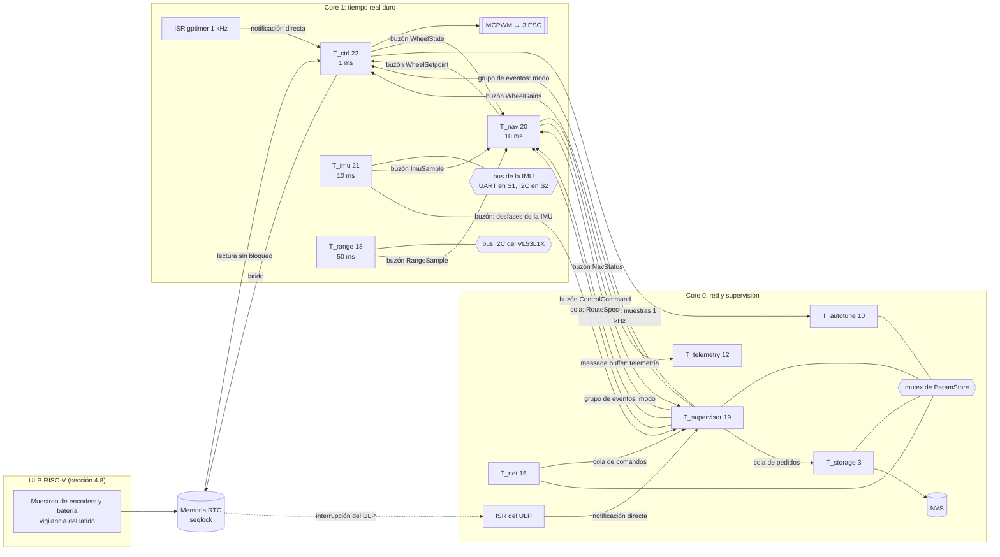

# Entrega 1 · Sección 3 — Diseño FreeRTOS y tabla de tiempo real

**Proyecto:** firmware unificado Striker v3 (ESP32-S3) · Howlers FC / Robosyn · Universidad de Antioquia
**Rama:** `entrega-1` de `afzo1/howlers-source` · **Fecha:** 18 de noviembre de 2026
**Herramientas:** [`analisis_tiempo_real.py`](herramientas/analisis_tiempo_real.py) con el conjunto de tareas [`tareas_v3.json`](herramientas/tareas_v3.json)

---

## Resumen

1. **Planificación particionada**: cada tarea está fijada a un núcleo. El Core 0 tiene el WiFi, LwIP, los comandos UDP, la telemetría, el autotuning y la supervisión; el **Core 1 solo tiene el lazo de tiempo real**: lectura de sensores, estimación, control y MCPWM (hallazgo C1).
2. El lazo de ruedas (`T_ctrl`, 1 kHz) lo activa un **temporizador de hardware** (`gptimer`) desde una ISR en IRAM con una **notificación directa**; las tareas de 10 ms y 50 ms usan `vTaskDelayUntil` (hallazgos T1, T2, C7).
3. **No hay variables globales compartidas sin protección**: cada dato tiene un solo productor y viaja por una primitiva de FreeRTOS (buzones con `xQueueOverwrite`, colas, *stream* y *message buffers*, grupos de eventos) o, desde el ULP, por un *seqlock*. Los recursos compartidos usan **mutex con herencia de prioridad**, y ningún mutex se comparte entre núcleos (hallazgos C2, C3, C5, C6).
4. Prioridades por **Deadline Monotonic** dentro de cada núcleo. Con los presupuestos de cómputo de diseño, la **utilización del Core 1 es 0,18** y todas las tareas cumplen **R ≤ D** en los dos robots; el cómputo podría crecer entre 1,7 y 5,3 veces antes de perder un plazo (3.8).
5. Un **plan de instrumentación** mide en la Entrega 2 el WCET, el *jitter*, la pila libre y la carga de cada núcleo, con criterios de aceptación definidos de antemano (3.9).

---

## 3.1 Principios del diseño

1. **Particionar, no compartir.** Las tareas de tiempo real no compiten con la red: viven en otro núcleo. Así el análisis de cada núcleo es el clásico de un solo procesador.
2. **Un dueño por recurso.** Cada periférico y cada dato tiene una sola tarea que lo escribe. Si dos tareas necesitan un bus, lo comparten con un mutex, y siempre dentro del mismo núcleo.
3. **El lazo rápido no espera a nadie.** `T_ctrl` nunca toma un mutex, nunca bloquea en una cola y nunca toca el ADC ni la red: lee buzones, calcula y escribe el MCPWM.
4. **El tiempo lo marca el hardware.** El periodo de 1 ms sale de un `gptimer`, no del *tick* ni de un retardo relativo.
5. **Todo dato lleva su marca de tiempo.** Así cada consumidor puede saber si el dato es viejo y reaccionar (3.10).

---

## 3.2 Asignación de núcleos y tareas

### 3.2.1 Tabla de tareas

| Núcleo | Tarea | Prioridad | Activación | Función |
|---|---|---:|---|---|
| 1 | ISR del `gptimer` | (ISR) | Cada 1 ms | Notifica a `T_ctrl` y guarda el instante de llegada (contador de ciclos) |
| 1 | `T_ctrl` | 22 | Notificación del `gptimer` (1 kHz) | Encoders (ULP) → velocidad de rueda → 3 PID → MCPWM; muestras de autotuning |
| 1 | `T_imu` | 21 | `vTaskDelayUntil`, 10 ms | Lee la IMU (I2C o UART) y publica la muestra |
| 1 | `T_nav` | 20 | `vTaskDelayUntil`, 10 ms, desfasada 6 ms | Estimador (EKF), trayectoria, seguidor, cinemática inversa → consignas de rueda |
| 1 | `T_range` | 18 | `vTaskDelayUntil`, 50 ms | Lee el VL53L1X |
| 1 | IPC1 (sistema) | 24 | Llamadas entre núcleos de ESP-IDF (raras) | Con la ejecución desde PSRAM, escribir la flash ya no la usa para detener el núcleo (sección 4.3) |
| 0 | WiFi (sistema) | 23 | Eventos de red | — |
| 0 | `esp_timer` (sistema) | 22 | — | v3 no registra *callbacks* de control aquí |
| 0 | Eventos (sistema) | 20 | Eventos del WiFi | — |
| 0 | `T_supervisor` | 19 | `vTaskDelayUntil`, 20 ms, y notificaciones | Máquina de estados, seguridad, batería, latidos |
| 0 | LwIP `tcpip` (sistema) | 18 | Paquetes | Fijada al Core 0 (por defecto no tiene afinidad) |
| 0 | `T_net` | 15 | Llegada de un datagrama UDP | Recibe, valida y encola comandos de la app web |
| 0 | `T_telemetry` | 12 | `vTaskDelayUntil`, 20 ms | Envía la telemetría por UDP |
| 0 | `T_autotune` | 10 | *Stream buffer* con 100 muestras | Cliente TCP del servidor de autotuning |
| 0 | `T_storage` | 3 | Cola de pedidos | Escrituras en NVS, solo en Idle |
| 0 | `app_main` | 1 | Una vez | Arranque; termina al liberar la barrera de inicio |

Las prioridades del sistema son las de ESP-IDF 5.5 ([`speed.rst:218-223`](https://github.com/espressif/esp-idf/blob/v5.5.1/docs/en/api-guides/performance/speed.rst#L218-L223)); FreeRTOS tiene 25 niveles ([`FreeRTOSConfig.h:93`](https://github.com/espressif/esp-idf/blob/v5.5.1/components/freertos/config/include/freertos/FreeRTOSConfig.h#L93)). Solo compiten las tareas del mismo núcleo: por eso `T_ctrl` (22) y el WiFi (23) no se afectan.

### 3.2.2 Configuración que garantiza la partición

ESP-IDF deja algunas tareas del sistema sin afinidad por defecto; si se quedan así, el planificador puede llevarlas al Core 1. En `sdkconfig.defaults` de v3:

| Opción | Valor | Por qué |
|---|---|---|
| `CONFIG_LWIP_TCPIP_TASK_AFFINITY_CPU0` | y | Por defecto LwIP no tiene afinidad ([`lwip/Kconfig:883-885`](https://github.com/espressif/esp-idf/blob/v5.5.1/components/lwip/Kconfig#L883-L885)) |
| `CONFIG_FREERTOS_TIMER_TASK_AFFINITY_CPU0` | y | La tarea de *timers* de FreeRTOS tampoco ([`freertos/Kconfig:187-190`](https://github.com/espressif/esp-idf/blob/v5.5.1/components/freertos/Kconfig#L187-L190)) |
| `CONFIG_ESP_WIFI_TASK_PINNED_TO_CORE_0` | y | Ya es el valor por defecto; se deja explícito |
| `CONFIG_ESP_TIMER_TASK_AFFINITY_CPU0`, `CONFIG_ESP_TIMER_ISR_AFFINITY_CPU0` | y | Ídem |
| `CONFIG_ESP_MAIN_TASK_AFFINITY_CPU0` | y | Ídem |
| `CONFIG_FREERTOS_HZ` | 1000 | *Tick* de 1 ms para `vTaskDelayUntil` y los tiempos de espera (hallazgo T3) |

Las **interrupciones** se asignan al núcleo desde el que se instalan ([`intr_alloc.rst:85`](https://github.com/espressif/esp-idf/blob/v5.5.1/docs/en/api-reference/system/intr_alloc.rst#L85)); el `gptimer` instala la suya al registrar el *callback* ([`gptimer.c:281-291`](https://github.com/espressif/esp-idf/blob/v5.5.1/components/esp_driver_gptimer/src/gptimer.c#L281-L291)). Por eso el `gptimer`, el I2C y la UART de los sensores se inicializan desde tareas del Core 1, y sus ISR corren allí; las del WiFi quedan en el Core 0.

---

## 3.3 Diagrama de tareas y comunicación



---

## 3.4 Primitivas de comunicación

Todos los objetos se crean con las variantes estáticas de FreeRTOS, en DRAM interna, antes de liberar la barrera de inicio.

| Objeto | Primitiva | Productor → consumidor | Contenido / tamaño | Política | Por qué esta primitiva |
|---|---|---|---|---|---|
| `ntf_ctrl` | Notificación directa (`vTaskNotifyGiveFromISR`) | ISR `gptimer` → `T_ctrl` | Contador de activaciones | `ulTaskNotifyTake(pdTRUE, 2 ms)`; si devuelve más de 1, hubo activaciones perdidas | La forma más rápida de despertar una tarea desde una ISR; no necesita objeto aparte |
| `mb_wheel_sp` | Buzón: cola de 1 elemento con `xQueueOverwrite` | `T_nav` → `T_ctrl` | `WheelSetpoint` (3 × rad/s, secuencia, marca de tiempo), 24 B | `T_ctrl` usa `xQueuePeek` sin espera; consigna vieja > 30 ms → cero | Solo importa el último valor; el productor nunca bloquea |
| `mb_wheel_state` | Buzón | `T_ctrl` → `T_nav` | Velocidades promedio de los últimos 10 ms y estado del lazo | `xQueuePeek` sin espera | Ídem |
| `mb_imu` | Buzón | `T_imu` → `T_nav` | `ImuSample`, 32 B | Edad > 25 ms → el EKF corrige sin IMU | Ídem |
| `mb_range` | Buzón | `T_range` → `T_nav` | `RangeSample` | Ídem | Ídem |
| `mb_ctrl_cmd` | Buzón | `T_supervisor` → `T_nav` | Modo, velocidad de teleoperación (`BodyTwist`), secuencia y marca de tiempo, 32 B | `xQueuePeek` en cada ciclo | Solo importa la última orden |
| `q_route` | Cola de 1 elemento | `T_supervisor` → `T_nav` | `RouteSpec` ya validado, 536 B | `T_nav` hace `xQueueReceive` sin espera; llega una vez por ruta | La ruta llega **copiada**: `T_nav` no toca la memoria del Core 0, y no se copian 536 B en cada ciclo como pasaría con un buzón |
| `mb_gains` | Buzón | `T_supervisor` → `T_ctrl` | `WheelGains` | Se aplican solo con las ruedas en parada | Las ganancias cambian sin mutex en el lazo rápido |
| `mb_nav_status` | Buzón | `T_nav` → `T_supervisor` | Pose, error de seguimiento, fin de ruta, salud del estimador | `xQueuePeek` | Ídem |
| `mb_imu_cal` | Buzón | `T_imu` → `T_supervisor` | Estado y desfases de calibración del BNO055 | Solo en Calibración | `T_imu` es el único dueño del bus de la IMU; `T_supervisor` pide guardar los desfases |
| `q_cmd` | Cola de 8 elementos | `T_net` → `T_supervisor` | Comandos validados (≤ 64 B) | `T_net` encola sin espera; si está llena, responde "ocupado" | Los comandos no se pueden perder ni sobrescribir: el orden importa |
| `q_storage` | Cola de 4 elementos | `T_supervisor` → `T_storage` | Pedidos de guardar un parámetro | Ídem | Ídem |
| `sb_autotune` | *Stream buffer*, 16 KB | `T_ctrl` → `T_autotune` | `AutotuneSample` de 64 B a 1 kHz | `T_ctrl` escribe sin espera; nivel de disparo 6400 B (100 muestras) | Un escritor y un lector, flujo continuo de bytes, despierta al lector por lotes |
| `mbuf_telemetry` | *Message buffer*, 4 KB | `T_nav` → `T_telemetry` | Tramas de telemetría de longitud variable | `T_nav` escribe sin espera; si no cabe, cuenta la pérdida | Conserva los límites de cada trama |
| `eg_mode` | Grupo de eventos | `T_supervisor` → todas | Un bit por modo + `ARMED` + `STORAGE_BUSY` | Lectura con `xEventGroupGetBits` al inicio de cada ciclo | Varias tareas leen el mismo estado; las que esperan un modo (`T_autotune`) bloquean en su bit |
| `eg_system` | Grupo de eventos | Arranque → todas | `INIT_DONE`, `WIFI_UP`, `ULP_READY`, `SENSORS_READY` | Todas las tareas esperan `INIT_DONE` antes de su lazo | Barrera de arranque (hallazgo C8) |
| `ntf_supervisor` | Notificación con bits (`xTaskNotifyFromISR`, `eSetBits`) | ISR del ULP → `T_supervisor` | Batería crítica, vigilancia vencida | Inmediata | Ver la nota siguiente |

**Por qué el ULP no usa el grupo de eventos desde la ISR.** `xEventGroupSetBitsFromISR` no pone los bits en la ISR: delega la operación en la tarea de *timers* de FreeRTOS ([`event_groups.c:805-812`](https://github.com/espressif/esp-idf/blob/v5.5.1/components/freertos/FreeRTOS-Kernel/event_groups.c#L805-L812)), que por defecto tiene prioridad 1 ([`freertos/Kconfig:211-214`](https://github.com/espressif/esp-idf/blob/v5.5.1/components/freertos/Kconfig#L211-L214)). Una falla de batería esperaría a todo lo demás. La notificación directa a `T_supervisor` (prioridad 19) es inmediata.

**Reglas de uso de los *buffers*.** Los *stream* y *message buffers* de FreeRTOS admiten un solo escritor y un solo lector. Por eso la telemetría del lazo de ruedas no escribe en `mbuf_telemetry`: la publica en `mb_wheel_state`, y `T_nav` la incluye en su trama. Los dos *buffers* están en DRAM interna porque los escribe el Core 1; la copia masiva a PSRAM la hacen sus lectores en el Core 0 (sección 4.2).

---

## 3.5 Recursos compartidos, mutex y herencia de prioridad

### 3.5.1 Qué se protege y cómo

| Recurso | Quién lo usa | Protección | Sección crítica más larga | Notas |
|---|---|---|---|---|
| `ParamStore`: copia en RAM de los parámetros (ganancias, ruta, límites, calibración), de la capa 4 (sección 2.2) | `T_supervisor` (19), `T_net` (15), `T_autotune` (10), `T_storage` (3) | Mutex con herencia de prioridad (`xSemaphoreCreateMutexStatic`) | Copia de una estructura, ≤ 5 µs | Todo en el Core 0. Al Core 1 llegan copias por buzón o cola. Nunca se escribe la flash con el mutex tomado. La persistencia en NVS la hace solo `T_storage`, a través de `IParamStore` |
| Bus I2C de la IMU (S2) | `T_imu` (único usuario) | Mutex de la HAL por bus | Una transacción, ≤ 1 ms | La calibración del BNO055 (estado y desfases) también la hace `T_imu`, a pedido, y publica los desfases en `mb_imu_cal` |
| Bus I2C del VL53L1X | `T_range` (único usuario) | Mutex de la HAL por bus | Una transacción, ≤ 0,6 ms | En S2 la IMU y el VL53L1X están en pines distintos (sección 2.6.2): cada uno usa uno de los dos controladores I2C del ESP32-S3 |
| UART de la IMU (S1) | `T_imu` | Ninguna: un solo dueño | — | — |
| NVS | `T_storage` | Ninguna: un solo dueño | — | Política de escritura en 4.3 |
| Memoria compartida con el ULP | ULP (escribe), `T_ctrl` y `T_supervisor` (leen) | Protocolo de secuencia (*seqlock*), sin bloqueo | — | Sección 4.8.4 |
| Buzones, colas y *buffers* que cruzan de núcleo | Ver 3.4 | *Spinlock* interno de FreeRTOS | Copia del elemento: ≤ 2 µs (536 B de `RouteSpec`) | Es la única espera posible entre núcleos |

### 3.5.2 Herencia de prioridad: dónde importa

**`ParamStore`.** Es el recurso compartido con más usuarios. Sin herencia, este caso sería posible: `T_storage` (3) toma el mutex para copiar las ganancias que va a guardar; llega un comando y `T_supervisor` (19) pide el mismo mutex y se bloquea; mientras tanto `T_telemetry` (12) expropia a `T_storage`, y `T_supervisor` queda esperando a una tarea que ni siquiera usa el recurso. Es la **inversión de prioridad no acotada**. Con el mutex de FreeRTOS, `T_storage` hereda la prioridad 19 mientras tiene el mutex, termina su copia de 5 µs y lo suelta; la espera de `T_supervisor` queda acotada por esa copia (el término B de la tabla 3.8). Por la misma razón, `T_storage` copia el dato y suelta el mutex **antes** de escribir la flash.

**Buses I2C.** El driver `i2c_master` de ESP-IDF 5.5 ya serializa el bus, pero con un **semáforo binario** ([`i2c_master.c:1015`](https://github.com/espressif/esp-idf/blob/v5.5.1/components/esp_driver_i2c/i2c_master.c#L1015)), que no tiene herencia de prioridad. Hoy cada bus tiene un solo usuario, pero si mañana se agrega un sensor al bus de la IMU y lo lee `T_nav` (20), un semáforo binario permitiría la misma inversión de arriba contra `T_imu` (21). Por eso la HAL envuelve cada transacción en un mutex de FreeRTOS: como todos los usuarios pasan primero por ese mutex, el semáforo interno del driver nunca tiene competencia, y la herencia queda garantizada sin depender de cuántos usuarios tenga el bus.

### 3.5.3 Regla: ningún mutex cruza de núcleo

La herencia de prioridad sube la prioridad de quien tiene el mutex, pero en *su* núcleo. Si una tarea del Core 1 esperara un mutex de una tarea del Core 0, esa tarea podría seguir expropiada por el WiFi (23) o por `esp_timer` (22), y la espera del Core 1 dependería del tráfico de red. Para evitarlo:
- los buses de los sensores solo los usan tareas del Core 1;
- `ParamStore` solo lo usan tareas del Core 0;
- los datos que cruzan de núcleo viajan **copiados** en buzones, colas y *buffers*, cuyas secciones críticas son de microsegundos.

Así el análisis de bloqueos de cada núcleo es el de un solo procesador con herencia de prioridad: el bloqueo máximo de una tarea (B) es la sección crítica más larga de una tarea de menor prioridad que use el mismo recurso, más la copia más larga de una primitiva compartida con el otro núcleo. Con eso, en la tabla 3.8: B = 5 µs para `T_ctrl` y `T_imu` (copias de buzones de 24-44 B), B = 20 µs para `T_nav` (incluye recibir la `RouteSpec` de 536 B) y B = 20 µs para las tareas del Core 0 que usan `ParamStore`. Son cotas holgadas: en la Entrega 2 se miden con los mismos contadores de ciclos de 3.9.

---

## 3.6 Política de planificación y prioridades

- **Planificación expropiativa por prioridad fija** (`configUSE_PREEMPTION = 1`, el valor de ESP-IDF: [`FreeRTOSConfig.h:86`](https://github.com/espressif/esp-idf/blob/v5.5.1/components/freertos/config/include/freertos/FreeRTOSConfig.h#L86)). Las tareas de un mismo núcleo tienen prioridades distintas, así que el reparto por turnos no interviene.
- **Deadline Monotonic** dentro de cada núcleo: menor plazo, mayor prioridad. En el Core 1 coincide con Rate Monotonic salvo por `T_imu` y `T_nav`, que tienen el mismo periodo: `T_imu` (D = 5 ms) va por encima de `T_nav` (D = 10 ms) porque su dato alimenta al estimador.
- Las tareas de 10 ms están **desfasadas**: `T_nav` arranca 6 ms después de `T_imu`, un margen mayor que el peor tiempo de respuesta de `T_imu` (4,6 ms con la TM151). Así el estimador usa la muestra del mismo periodo. El desfase se fija al liberar la barrera de inicio, que es común a todas las tareas.
- En el Core 0 hay tres tareas con plazo de 20 ms; el empate se resuelve por importancia: supervisión, órdenes y telemetría. `T_supervisor` (19) queda por encima de LwIP (18) para que la seguridad no dependa del tráfico; `T_net` queda por debajo de LwIP, que es quien le entrega los paquetes.

---

## 3.7 Activación periódica exacta

### 3.7.1 El lazo de 1 kHz

```cpp
// ISR del gptimer: en IRAM y segura con la caché desactivada (sección 4.3).
static volatile uint32_t s_isr_cycles;                // ciclo de CPU en que entró la ISR

static bool IRAM_ATTR on_alarm(gptimer_handle_t, const gptimer_alarm_event_data_t*, void*)
{
    s_isr_cycles = esp_cpu_get_cycle_count();
    BaseType_t woken = pdFALSE;
    vTaskNotifyGiveFromISR(s_ctrl_task, &woken);
    return woken == pdTRUE;                           // pide el cambio de contexto al salir
}

// T_ctrl (Core 1, prioridad 22). Su código va en IRAM y sus datos en DRAM (sección 4.2).
void IRAM_ATTR ctrl_task(void*)
{
    xEventGroupWaitBits(eg_system, INIT_DONE, pdFALSE, pdTRUE, portMAX_DELAY);
    for (;;) {
        const uint32_t n = ulTaskNotifyTake(pdTRUE, pdMS_TO_TICKS(2));
        const uint32_t t0 = esp_cpu_get_cycle_count();
        dbg_pin_set(DBG_CTRL);
        if (n == 0) {                                 // el temporizador no llegó en 2 ms
            motors.stopAll();
            safety.report(Event::ControlOverrun);
            dbg_pin_clear(DBG_CTRL);
            continue;
        }
        stats.lost(n - 1);                            // n > 1: se perdieron activaciones
        wheel_controller.step();  // encoders → velocidad → 3 PID → MCPWM → muestra de autotuning
        ulp_heartbeat++;          // latido para la vigilancia del ULP (sección 4.8.6)
        stats.record(t0 - s_isr_cycles,               // latencia de la ISR a la tarea
                     esp_cpu_get_cycle_count() - t0); // tiempo de ejecución
        dbg_pin_clear(DBG_CTRL);
    }
}
```

- El `gptimer` cuenta a 1 MHz con recarga automática cada 1000 cuentas: el periodo no deriva ni depende de cuánto tardó el ciclo anterior (al revés de `vTaskDelay`, hallazgo T1).
- La ISR no usa `esp_timer`: sus *callbacks* se ejecutan en una tarea del Core 0, compartida con otros temporizadores (hallazgo C7).
- Con `CONFIG_GPTIMER_ISR_CACHE_SAFE` ([`Kconfig:19`](https://github.com/espressif/esp-idf/blob/v5.5.1/components/esp_driver_gptimer/Kconfig#L19)) la ISR queda en IRAM: tiene menor latencia y, en el plan B sin ejecución desde PSRAM (sección 4.3), sigue funcionando aunque una escritura en flash desactive la caché, así que el conteo de activaciones perdidas es exacto también en ese caso.
- La ISR y `T_ctrl` corren en el mismo núcleo, así que el contador de ciclos de la CPU (240 MHz, frecuencia fija: sin gestión de energía, sección 4.5) mide la latencia de activación con una resolución de 4 ns sin leer ningún periférico.
- Si se pierden 3 activaciones seguidas con los motores armados, `T_ctrl` pasa a parada y avisa `ControlOverrun`. Con la ejecución desde PSRAM, escribir en NVS no detiene las CPU (sección 4.3). El bit `STORAGE_BUSY` queda para el plan B: sin esa función, la escritura sí detendría los dos núcleos; como solo se escribe en Idle y con los motores desarmados, mientras el bit está activo la vigilancia de activaciones perdidas se suspende.

### 3.7.2 Las tareas de 10 y 50 ms

```cpp
void imu_task(void*)
{
    xEventGroupWaitBits(eg_system, INIT_DONE, pdFALSE, pdTRUE, portMAX_DELAY);
    TickType_t last = xTaskGetTickCount();
    for (;;) {
        vTaskDelayUntil(&last, pdMS_TO_TICKS(10));   // instante absoluto: no acumula deriva
        ImuSample s;
        if (imu.read(s) == Status::Ok) { xQueueOverwrite(mb_imu, &s); }
        else                           { imu_errors++; }
    }
}
```

`vTaskDelayUntil` calcula el próximo instante a partir del anterior, no del momento en que la tarea terminó; con el *tick* de 1 ms, su resolución es 1 ms y su variación es la latencia de la interrupción del *tick*. Para estas tareas basta; el lazo de 1 kHz, que sí necesita microsegundos, usa el `gptimer`.

### 3.7.3 El lazo de ruedas frente al ESC de 50 Hz

Los ESC reciben pulsos de 50 Hz: la salida del PID solo cambia el actuador cada 20 ms (hallazgo T4). Aun así, el lazo de ruedas corre a 1 kHz por dos razones: los modelos LSTM del autotuning se entrenaron con ese periodo y esa ecuación, y el PID necesita la velocidad muestreada rápido para su integral y su derivada filtrada. Los comparadores del MCPWM se actualizan en el evento TEZ (inicio de cada pulso), así que nunca se emite un pulso a medio cambiar. La frecuencia del PWM queda en `RobotConfig::esc_pulse.pwm_hz` (50 Hz por defecto): si el modelo del ESC admite más (muchos aceptan hasta 400 Hz), se podrá subir y medir la mejora, pero solo después de identificar el ESC, porque es un dato del hardware que todavía no se conoce.

---

## 3.8 Tabla de tiempo real

### 3.8.1 Presupuestos de cómputo (C)

Los C de esta tabla son **presupuestos de diseño**, no mediciones: un estimado del trabajo de cada tarea con un margen de 2 a 3 veces. En la Entrega 2 se reemplazan por los WCET medidos (3.9) y se vuelve a correr el análisis.

| Tarea | C | De dónde sale |
|---|---|---|
| `T_ctrl` | 60 µs | Copia de la ronda del ULP (~1 µs); 3 conversiones a ángulo con desenvolvimiento y filtro (~100 operaciones `float`); 3 PID (~60 operaciones); 6 escrituras de comparador del MCPWM (en IRAM); muestra de 64 B al *stream buffer* (~3 µs); buzones y estadísticas. Estimado: 15-25 µs a 240 MHz |
| `T_imu` | 250 µs de CPU + E/S | E/S: una lectura de 18 B del BNO055 a 400 kHz (~0,6 ms → presupuesto 1 ms) o una consulta a la TM151 a 115 200 baudios (~34 B entre pregunta y respuesta, ~3 ms → presupuesto 4 ms). El código de S1 escribe 115600 ([`control_main.h:40`](https://github.com/afzo1/howlers-source/blob/0451897bc2c902e6e356acf153d503e0143c7b3a/firmware/apps/striker_v1/robot-mov/main/include/control_main.h#L40)), un error de digitación del 0,35 % que la UART tolera; v3 usa 115 200 |
| `T_nav` | 800 µs | EKF de 6 estados y 4 mediciones (~2000 operaciones `float`, con la sobrecarga de la biblioteca genérica, ~200 µs); trayectoria y seguidor (~10 `sinf`/`cosf`); cinemática; trama de telemetría; fallos de caché del código en flash |
| `T_range` | 100 µs + 600 µs de E/S | Lectura del resultado del VL53L1X por I2C |
| `T_supervisor` | 300 µs | Máquina de estados, revisiones de seguridad, lectura de la batería |
| `T_net` | 200 µs por comando | `recvfrom` + decodificación y validación de un comando corto |
| `T_telemetry` | 500 µs por trama | Codificación + `sendto` |
| `T_autotune` | 2,5 ms por lote | Envío de 100 muestras (6,4 KB) por TCP |

Las ISR y las tareas del sistema se modelan como tareas de mayor prioridad con un presupuesto: en el Core 1, *tick*, `gptimer` y periféricos de la IMU (1 % en total); en el Core 0, ISR del WiFi (2 %), tareas WiFi, `esp_timer` y eventos (15 %) y LwIP (10 %). Estos porcentajes del sistema son supuestos que se miden en la Entrega 2 con `vTaskGetRunTimeStats`.

Las tareas que esperan E/S se analizan contando la espera como cómputo (*suspension-oblivious*): es pesimista, pero seguro.

### 3.8.2 Resultados

Salida de `python3 docs/striker_v3/herramientas/analisis_tiempo_real.py docs/striker_v3/herramientas/tareas_v3.json`, que aplica el análisis de tiempo de respuesta (Joseph y Pandya; Audsley y otros):

R = C + B + Σ<sub>j de mayor prioridad</sub> ⌈(R + J<sub>j</sub>) / T<sub>j</sub>⌉ · C<sub>j</sub>

**Striker 1 (IMU TM151 por UART)**

| Núcleo | Prio | Tarea | T (µs) | D (µs) | C (µs) | B (µs) | U | R (µs) | ¿R ≤ D? |
|---|---:|---|---:|---:|---:|---:|---:|---:|:---:|
| 1 | 22 | `T_ctrl` | 1 000 | 500 | 60 | 5 | 0,060 | 75 | sí |
| 1 | 21 | `T_imu` | 10 000 | 5 000 | 4 250 | 5 | 0,425 | 4 605 | sí |
| 1 | 20 | `T_nav` | 10 000 | 10 000 | 800 | 20 | 0,080 | 5 490 | sí |
| 1 | 18 | `T_range` | 50 000 | 50 000 | 700 | 0 | 0,014 | 6 240 | sí |
| 0 | 19 | `T_supervisor` | 20 000 | 20 000 | 300 | 20 | 0,015 | 1 866 | sí |
| 0 | 15 | `T_net` | 5 000 | 20 000 | 200 | 20 | 0,040 | 3 112 | sí |
| 0 | 12 | `T_telemetry` | 20 000 | 20 000 | 500 | 0 | 0,025 | 3 592 | sí |
| 0 | 10 | `T_autotune` | 100 000 | 100 000 | 2 500 | 20 | 0,025 | 6 381 | sí |

**Striker 2 (IMU BNO055 por I2C)**: cambia solo el Core 1.

| Núcleo | Prio | Tarea | T (µs) | D (µs) | C (µs) | B (µs) | U | R (µs) | ¿R ≤ D? |
|---|---:|---|---:|---:|---:|---:|---:|---:|:---:|
| 1 | 22 | `T_ctrl` | 1 000 | 500 | 60 | 5 | 0,060 | 75 | sí |
| 1 | 21 | `T_imu` | 10 000 | 5 000 | 1 250 | 5 | 0,125 | 1 395 | sí |
| 1 | 20 | `T_nav` | 10 000 | 10 000 | 800 | 20 | 0,080 | 2 280 | sí |
| 1 | 18 | `T_range` | 50 000 | 50 000 | 700 | 0 | 0,014 | 2 960 | sí |

| Núcleo | Utilización de CPU | U contando la E/S como cómputo | Cota de Liu y Layland | Factor de holgura |
|---|---:|---:|---:|---:|
| Core 1 (S1) | 0,177 | 0,589 | 0,729 (n = 7) | 1,72 |
| Core 1 (S2) | 0,177 | 0,289 | 0,729 (n = 7) | 5,26 |
| Core 0 (S1 y S2) | 0,378 | 0,378 | 0,724 (n = 8) | 6,92 |

El **factor de holgura** es cuánto puede multiplicarse el cómputo de todas las tareas propias antes de que alguna pierda su plazo (búsqueda binaria en el mismo script).

### 3.8.3 Lectura de los resultados

- **Todas las tareas cumplen R ≤ D** en los dos robots y en los dos núcleos. La prueba que vale es el análisis de tiempo de respuesta, que es exacto para prioridades fijas con plazos menores o iguales al periodo. La cota de Liu y Layland se muestra solo como referencia: supone D = T, y aquí `T_ctrl` y `T_imu` tienen plazos más cortos que su periodo.
- El lazo de ruedas responde en 75 µs, bien dentro de su plazo de 500 µs. Ese plazo es más corto que el periodo a propósito: limita a medio milisegundo la latencia entre leer el encoder y mover el actuador.
- En Striker 1 el cuello de botella es la **IMU TM151**: su consulta serie de unos 4 ms ocupa casi todo el plazo de `T_imu` y deja la holgura en 1,72. Dos mejoras posibles, a evaluar con el robot: configurar la TM151 para que transmita sola a un ritmo fijo (sin pregunta y respuesta) o subir la velocidad del puerto serie. Ninguna cambia la arquitectura.
- `T_net` es esporádica: atiende como mucho un comando cada 5 ms (los demás esperan en la cola de LwIP), y su plazo de 20 ms es mayor que esa separación. Como su R (3,1 ms) es menor que 5 ms, cada comando termina antes de que llegue el siguiente y el análisis estándar sigue siendo válido.
- `T_storage` no entra en el análisis: tiene la prioridad más baja del Core 0 y no tiene plazo, y su único efecto sobre las demás tareas es el mutex de `ParamStore`, ya contado en B. Con la ejecución desde PSRAM, escribir la flash no detiene las CPU (sección 4.3).

---

## 3.9 Plan de instrumentación (Entrega 2)

### 3.9.1 Qué se mide y cómo

| Magnitud | Herramienta | Dónde | Costo | Salida |
|---|---|---|---|---|
| Tiempo de ejecución de cada tarea y de sus partes | `esp_cpu_get_cycle_count()` al inicio y al final (ciclos a 240 MHz) | Todas las tareas del Core 1 y `T_supervisor` | ~10 ciclos por lectura | Máximo, promedio e histograma en DRAM; se envían por telemetría cada segundo |
| Periodo y *jitter* de `T_ctrl` | Contador de ciclos leído en la ISR del `gptimer` y al despertar `T_ctrl` (mismo núcleo, 3.7.1) | `T_ctrl` | ~10 ciclos | Histograma del periodo entre activaciones y de la latencia ISR → tarea |
| Lo mismo, sin instrumentar el código | Pines de medición GPIO14 (`T_ctrl`), GPIO15 (`T_nav`) y GPIO16 (ISR), con GPIO dedicados del ESP32-S3 (una instrucción por cambio) | ISR, `T_ctrl`, `T_nav` | < 10 ns | Analizador lógico u osciloscopio: periodo, *jitter* y duración, independientes del software |
| Carga de cada tarea y de cada núcleo | `vTaskGetRunTimeStats()` con `CONFIG_FREERTOS_GENERATE_RUN_TIME_STATS` | Todo el sistema | Contador de 1 MHz | Porcentaje de CPU por tarea, incluidas las del sistema (comprueba los supuestos de 3.8.1) |
| Pila libre | `uxTaskGetStackHighWaterMark()` | Todas las tareas propias | Despreciable | Margen de cada pila (hallazgo M3) |
| Pérdidas y vencimientos | Contadores de activaciones perdidas, plazos incumplidos, datos viejos y tramas perdidas | Cada tarea | Despreciable | Telemetría |

Las mediciones se hacen con la **configuración de entrega**: optimización `-O2`, registros en nivel WARN y aserciones activas (hallazgo T6). Los contadores y los histogramas están en DRAM interna y no reservan memoria.

### 3.9.2 Experimentos

| # | Condición | Qué se busca |
|---|---|---|
| E1 | Robot en Idle, sin red | Línea base de *jitter* y carga |
| E2 | Teleoperación con telemetría a 50 Hz | Operación normal |
| E3 | Ruta en lazo cerrado + carga de red desde el PC (ráfagas UDP a la máxima tasa) | Que el tráfico del Core 0 no afecte al Core 1 |
| E4 | Autotuning: muestras a 1 kHz por TCP | Que el envío no deje huecos en las muestras |
| E5 | IMU desconectada o sin respuesta | Tiempos de espera y paso a Fault |
| E6 | Umbral de batería simulado en el ULP | Respuesta de la supervisión |

Cada experimento dura al menos 30 minutos (más de 1,8 millones de activaciones de `T_ctrl`). El WCET medido es el máximo observado; el presupuesto de la Entrega 2 será ese máximo con un margen del 20 %, y con esos valores se vuelve a correr `analisis_tiempo_real.py`.

### 3.9.3 Criterios de aceptación

| Criterio | Meta |
|---|---|
| Plazos | Ningún incumplimiento en ningún experimento |
| *Jitter* del periodo de `T_ctrl` | ≤ 10 µs en el 99,9 % de las activaciones y ≤ 25 µs en el peor caso |
| WCET de `T_ctrl` | ≤ 60 µs |
| Utilización del Core 1 | ≤ 50 % |
| Margen de pila | ≥ 25 % en todas las tareas |
| Muestras de autotuning | Cero huecos en E4 |

---

## 3.10 Supervisión y respuesta a fallas

| Situación | Quién la detecta | Plazo | Respuesta |
|---|---|---|---|
| No llega el latido de la app web | `T_supervisor` | 300 ms | `LinkTimeout` → Idle (parada) |
| La consigna de `T_nav` es vieja | `T_ctrl` | 30 ms | Consigna cero en las ruedas, por su cuenta |
| El ULP no publica una ronda nueva | `T_ctrl` | 2 ms | Parada y `UlpLost` → Fault |
| `T_ctrl` pierde 3 activaciones seguidas | `T_ctrl` | 3 ms | Parada y `ControlOverrun` → Fault |
| La IMU no responde | `T_imu` / `T_nav` | 25 ms | El EKF sigue solo con la odometría; si pasa de 500 ms en movimiento, `SensorFault` → Fault |
| Batería crítica | ULP → ISR → `T_supervisor` | 0,5 s de lecturas bajas (filtra las caídas al acelerar); luego < 1 ms hasta `T_supervisor` | `BatteryCritical` → Fault |
| `T_ctrl` deja de latir (bloqueo del Core 1) | ULP, de forma independiente | 60 ms | Aviso a `T_supervisor`, que detiene los motores y pasa a Fault; si no confirma en 100 ms más, el ULP reinicia el chip (sección 4.8.6) |
| Covarianza del EKF no definida positiva | `T_nav` | Inmediato | Reinicio del estimador; en Route, `SensorFault` |

Además queda activo el *watchdog* de tareas de ESP-IDF para `T_supervisor`, `T_net` y `T_telemetry` (5 s), como red de seguridad para bloqueos del Core 0.

---

## 3.11 Trazabilidad

| Hallazgo | Decisión | Dónde |
|---|---|---|
| C1 · Sin partición de núcleos | Partición fija; afinidades del sistema explícitas | 3.2 |
| C2 · Datos compartidos sin protección | Un dueño por dato; buzones, colas y *buffers* | 3.4 |
| C3 · Productor y consumidor sin sincronizar | Buzones con marca de tiempo y secuencia; desfase de `T_nav` | 3.4, 3.6 |
| C4 · Prioridades sin política | Deadline Monotonic por núcleo | 3.6 |
| C5 · E/S bloqueante dentro del lazo | La E/S está en `T_imu` y `T_range`; `T_ctrl` no bloquea | 3.1, 3.2 |
| C6 · ADC compartido con error fatal | El ADC lo usa solo el ULP | 3.5.1, sección 4.8 |
| C7 · *Callbacks* de `esp_timer` como si fueran ISR | ISR del `gptimer` + notificación directa | 3.7.1 |
| C8 · Arranque sin barrera | Grupo de eventos `eg_system` con `INIT_DONE` | 3.4 |
| T1 · Sin activación absoluta | `gptimer` y `vTaskDelayUntil` | 3.7 |
| T2 · Periodo sin garantías | Detección de activaciones perdidas y plazos | 3.7.1, 3.10 |
| T3 · *Tick* de 100 Hz | `CONFIG_FREERTOS_HZ = 1000` | 3.2.2 |
| T4 · Actuador de 50 Hz | Lazo a 1 kHz por compatibilidad; PWM configurable | 3.7.3 |
| T5 · Derivar un ángulo analógico | Muestreo uniforme en el ULP + estimador de velocidad filtrado | Sección 4.8 |
| T6 · Sin medición | Plan de instrumentación y criterios | 3.9 |
| T7 · Tres versiones de ESP-IDF | ESP-IDF v5.5.1 para todo | Sección 4.5 |
| F4 · Sin tiempos de espera | Tabla de supervisión | 3.10 |
